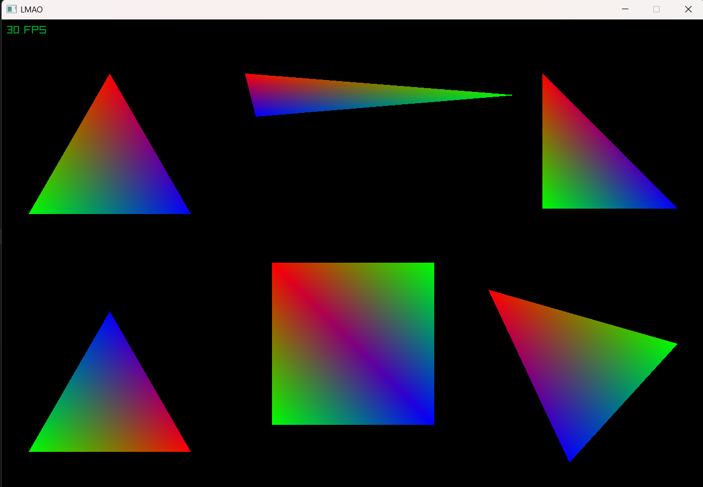

# lab3_triangulos

readme generado con ayuda de claude 

Laboratorio 3 de gráficas: dibujo de triángulos en 2D con Zig y raylib, usando **coordenadas baricéntricas** para interpolar colores RGB. Cada color se vuelve más intenso a medida que un píxel se acerca a su vértice, y la interpolación se ve bien sin importar la forma del triángulo (equilátero, isósceles, escaleno, rectángulo, muy alargado, etc.).

## Resultado



## Cómo funciona

Para cada píxel dentro de la caja delimitadora del triángulo:

1. Se calculan los tres pesos baricéntricos (uno por vértice) a partir de áreas con signo. El peso de cada vértice es el área del sub-triángulo opuesto dividida entre el área total.
2. Si algún peso es negativo, el píxel está fuera del triángulo y se omite.
3. El color del píxel es la suma de los colores de los vértices multiplicados por sus pesos, convertida a `rl.Color`.

Los triángulos degenerados (área casi cero) no se dibujan, y el orden de los vértices (horario o antihorario) no afecta el resultado.

## Estructura del proyecto

- `main.zig`: abre la ventana y dibuja varios triángulos de prueba (equilátero, alargado, rectángulo, vértices en orden contrario, un cuadrado hecho con dos triángulos y un escaleno).
- `triangle.zig`: triángulo 2D con colores por vértice, cálculo de pesos baricéntricos, interpolación y dibujo.
- `framebuffer.zig`: framebuffer en CPU sobre una imagen de raylib.
- `cute_colors.zig`: utilidad para adaptar colores de HTML a raylib.

## Compilación y ejecución

Requiere Zig 0.16.0. La dependencia `raylib_zig` está fijada en `build.zig.zon` a la revisión `bd161c82d4cc42d9ea7986d0c6a86daaae79e430`, compatible con esa versión de Zig.
Desde la raíz del proyecto:

```
zig version
zig build
zig build run
```

Para ejecutar las pruebas existentes:

```
zig build test
```

La primera compilación necesita internet para descargar las dependencias. Zig administra la carpeta `zig-pkg/`; no hace falta editarla ni subirla a Git.
No vuelvas a ejecutar `zig fetch --save ...#devel` para este proyecto: esa rama avanza con las versiones de desarrollo de Zig y la revisión que causó los errores requiere Zig 0.17.0. Los errores sobre `findProgram`, `Build.root` y `serializeConfigurationExiting` se debían a esa incompatibilidad.